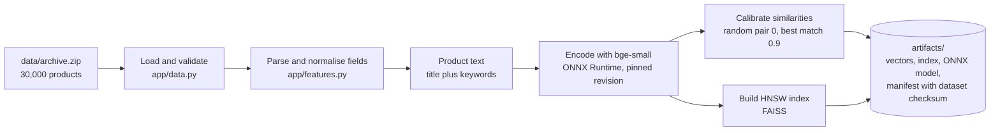
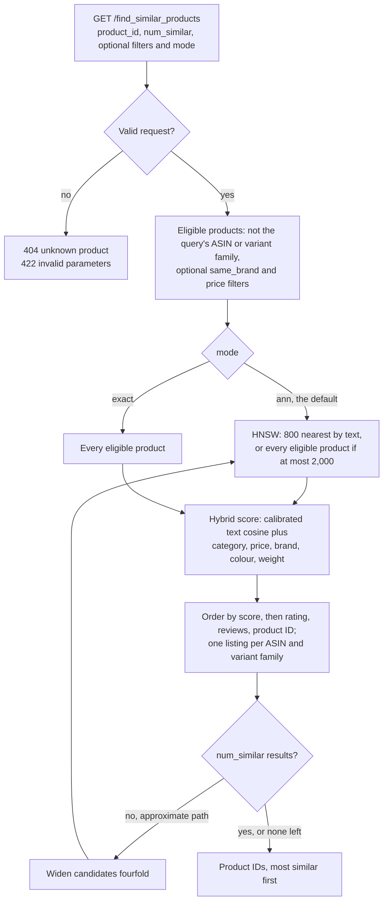
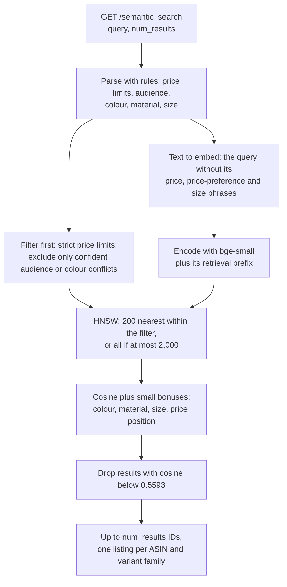
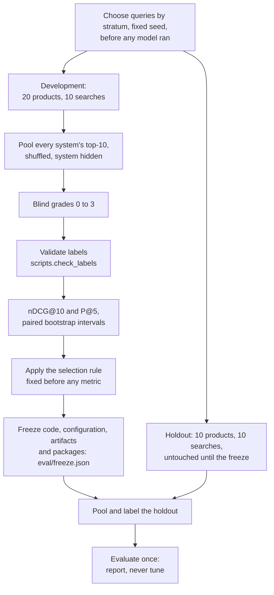
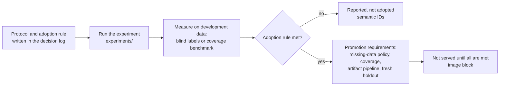

# Solution: approach, findings and implementation

How the service works, what we found while building it and what we built in response. The [README](README.md)
explains how to run it; [decision_summary.md](decision_summary.md) gives every decision in one line, with the key
trade-offs; [docs/decisions.md](docs/decisions.md) holds the full evidence and the alternatives rejected. References
such as (D05) point to entries there, and every number comes from a file in `reports/`.

## Contents

1. [Problem and framing](#1-problem-and-framing)
2. [Workflows](#2-workflows)
3. [Data](#3-data)
4. [Similar products](#4-similar-products)
5. [Text model and runtime](#5-text-model-and-runtime)
6. [Approximate search](#6-approximate-search)
7. [Semantic search](#7-semantic-search)
8. [Service and deployment](#8-service-and-deployment)
9. [Evaluation and results](#9-evaluation-and-results)
10. [Experiments (not served)](#10-experiments-not-served)
11. [Limitations and next steps](#11-limitations-and-next-steps)

## 1. Problem and framing

- **Task.** Given a product's `uniq_id`, return similar products from the Amazon Fashion 2020 catalogue (30,000
  products); given a free-text query, return matching products while honouring the filters it expresses. One
  service answers both the original exercise and its v2 specification (D02).
- **What "similar" means (D01).** A plausible substitute: a product a shopper might buy instead. Product type and
  use dominate; style, material, colour, brand and price refine the ranking. Other brands are eligible;
  complements and personalisation are out of scope. A definition a person can judge makes relevance measurable.
- **How choices were made (D07).** Competing options were compared on blind human relevance judgements, with the
  selection rule written down before any metric was computed. The chosen configuration was frozen and then
  checked once on held-out queries that no one had looked at. The experiments followed the same discipline:
  protocol and adoption rule first, results second.

## 2. Workflows

### 2.1 Build (offline)

Everything expensive happens once, before serving (D16): `python -m scripts.prepare`, which the Docker build runs
in its first stage.



At startup the service parses the catalogue again and becomes ready only if the dataset checksum, the pinned
model revision and the index size all match the manifest (`app/artifacts.py`); otherwise `/ready` reports why.

### 2.2 Similar products (per request)



### 2.3 Semantic search (per request)



### 2.4 Evaluation and freeze



### 2.5 Experiments



## 3. Data

The catalogue is messy in ways that decide results, so every field got an explicit parsing rule (D03), reproduced
by `python -m scripts.profile_data` (`reports/data_profile.json`).

| Finding | What we did |
|---|---|
| `weight` is the placeholder `999999999` for 79.15% of products, in mixed g and kg | Placeholder becomes missing; units normalised; 1 g to 20 kg accepted. Weight is usable for 20.8% |
| Brand missing for 27.1%, plus placeholders such as "Generic" and "Unknown" | Normalised (case, punctuation, Unicode); placeholders become missing |
| Price missing or invalid for 9.6%; ₹39 to ₹9,988, median ₹590 | Only a positive, finite `sales_price` counts. A regular price derived from the discount is kept as metadata, not scored, which would count price twice |
| The `colour` field lists the colours a listing is available in, not the item's colour | Item colour is read from the title (keywords as fallback), with conflicts flagged; 57% stay unknown rather than guessed |
| No category field | Leaf from the sales-rank map, else the browse node when it maps cleanly (at least 5 products, 80% purity); 4.2% unknown |
| Rating agrees with the review summary in only 58.9% of products | Not scored; used only to break ties |
| 471 duplicate-ASIN rows in 451 groups; size variants listed separately | The query's ASIN and variant family (same brand and normalised title) are excluded; at most one listing per ASIN and per family (D04) |
| Identical titles without a brand can be different products: five "Juniper Women's Straight Kurta" listings with different ASINs, prices (₹599 to ₹1,036) and images | Not merged: a shared title alone does not prove duplication |
| No product descriptions | Product text is the title plus the keyword tokens the title lacks |
| 17 footwear products (2 running shoes), no real wallets, no laptop backpacks; a garden plant filed as men's caps; one book | Documented as catalogue limits, not hidden or patched (D13) |
| 29,861 of 30,000 images usable (137 return HTTP 404, 2 have no URL) | Bounded, validated, resumable download from Amazon's image host only; images are never committed (D14) |

One rule runs through everything: **missing never matches missing**. Two products that both lack a brand do not
agree on brand.

## 4. Similar products

**Approach: evidence-aware late fusion (D05).** For a query product q and a candidate x:

```text
score(q, x) = Σ w·s over the components both products have
              ÷ max(Σ w over those components, 0.5 × Σ all w)
```

| Component | Similarity s | Weight w |
|---|---|---|
| Text | bge-small cosine, calibrated so a typical random pair maps to 0, a typical best match to 0.9 and an identical item to 1 | 0.50 |
| Category | Shared category | 0.20 (0.40 of the attribute block) |
| Price | exp(−\|ln a − ln b\| / ln 2), so ₹50 against ₹100 scores like ₹500 against ₹1,000 | 0.10 (0.20) |
| Brand | Exact match | 0.075 (0.15) |
| Colour | Overlap of colour families (Jaccard) | 0.075 (0.15) |
| Weight | The same log kernel as price | 0.05 (0.10) |
| Rating | Not scored; breaks ties | 0 |

Why this design:
- **Late fusion, not one concatenated vector:** every component stays interpretable, and missing data is handled
  pair by pair instead of being zero-filled.
- **Calibration:** representations have different baselines (random bge-small pairs already score about 0.59
  cosine). Without it, the modality with the higher baseline dominates and merely having a feature is rewarded.
- **Normalised numbers:** raw prices never meet unit vectors. Price and weight enter only through a bounded,
  scale-free log kernel, where halving or doubling gives 1/e.
- **Evidence floor:** a candidate matching on one cheap field cannot score as if it matched everything.
- **Cosine:** for unit vectors, cosine, dot product and Euclidean distance rank identically
  (‖a − b‖² = 2 − 2·cos a,b); cosine is interpretable and maps directly onto inner-product indexes.
- **Three tuned weights only** (text, image, attributes): 20 development queries cannot tune eight.

Ties are broken by rating, review count and product ID, so results are deterministic.

**Findings on the development labels:**
- *Text weight* (rule fixed before labelling): 0.5 stays. Only 0.6 scored higher, by 0.0055 nDCG@10, less than
  one standard error; 0.3 is clearly worse (−0.061, 95% interval −0.121 to −0.009).
- *Category matters:* removing it lowers nDCG@10 by 0.126 (95% interval 0.055 to 0.209).
- *Product type (D06):* scored on attributes alone, the right type can lose in three controlled cases, recorded as
  strict expected failures in `tests/test_type_dominance.py`; with text, all three pass. Only 3 of C_bge's 200
  development results are irrelevant products from another category, so no type penalty was added.
- *Title cap (D04):* allowing at most two listings per normalised title cuts repeated titles from 1.45 to 0.95 per
  top-10 and changes nDCG@10 by −0.001. It is available (`max_per_title`) but off by default.

## 5. Text model and runtime

**Comparison before labelling** (D09, `reports/text_model_comparison.json`; timings on CPU with PyTorch, before the
switch described below):

| | TF-IDF | all-MiniLM-L6-v2 | bge-small-en-v1.5 | all-mpnet-base-v2 |
|---|---|---|---|---|
| Dimensions / parameters | 36,372 sparse | 384 / 22.7 M | 384 / 33.4 M | 768 / 109.5 M |
| Encode 30,000 products | – | 26 s | 36 s | 133 s |
| Encode one query, median | – | 4.4 ms | 7.5 ms | 17.2 ms |
| Top-10 text neighbours sharing a category | 64.7% | 73.4% | 74.7% | 71.7% |

- **mpnet dropped:** four times slower and no better on this catalogue, which answers v2's "why not a larger model".
- **bge-small serves both endpoints.** On the development searches it beats MiniLM by 0.183 nDCG@10 (95% interval
  0.065 to 0.328); for similar products the two are indistinguishable (0.760 against 0.749). One model also means
  one vector set and one index. The cost is about 1.9 ms per search and 43 MB.
- **On the holdout** C_bge leads C_minilm by 0.077 nDCG@10 for similar products (0.006 to 0.170), but bge-small's
  search lead did not replicate: no pair of search models is separated. The choice was made on development data;
  the holdout assesses it without changing it.
- **Domain:** both models are general-domain English models, not trained on fashion, so Indian garment terms such
  as "kurti" may be weakly represented.

**A crash and its fix: ONNX Runtime instead of PyTorch (D17).** The first real search request crashed the service
with a segmentation fault: the FAISS and PyTorch wheels each bundle an OpenMP runtime, and with both loaded in one
process PyTorch inference crashed. Rather than avoid the trigger (one thread, a lucky import order,
`KMP_DUPLICATE_LIB_OK`), we removed PyTorch from the process. Products and queries are encoded with ONNX Runtime
running each model's own ONNX export, with tokenisation, truncation, pooling and normalisation reproduced from the
model's files and checked against the PyTorch reference:
- token IDs identical for all 30,000 product texts; embeddings agree to a cosine of at least 0.9999997;
- 54 of 60 development top-10 lists identical, and each of the other six swaps two listings with identical text
  whose scores differ by at most 1.2e-7;
- dependencies 64% smaller (1,436 MB to 522 MB unpacked); offline encoding about 20 s slower.

This is the decision in the one-page trade-off note ([docs/tradeoff_note.md](docs/tradeoff_note.md)).

## 6. Approximate search

**Design (D08).** FAISS HNSW (Malkov & Yashunin, 2018; M 32, efConstruction 200, efSearch 128; 54 MB) proposes
text candidates, and the exact hybrid scorer re-ranks them: 800 candidates for similar products, 200 for search.
Filters are applied inside the graph search through FAISS's ID selector; when a filter leaves 2,000 products or
fewer, all of them are scored exactly. If de-duplication leaves too few results, the candidate set widens fourfold.

**Rule fixed in advance:** approximate search becomes the default only if it returns at least 95% of the exact
top-10 (coverage). Measured in process on Apple silicon (`reports/ann_benchmark.json`):

| Query set | Candidates | Coverage of the exact top-10 | Median latency, approximate vs exact |
|---|---|---|---|
| Similar products, 20 development | 800 | 0.960 | 1.6 vs 6.1 ms |
| Similar products, 1,000 sampled | 800 | 0.991 | 1.5 vs 6.3 ms |
| Search, 10 development | 200 | 1.000 | 5.1 vs 7.7 ms |
| Search, 300 title pseudo-queries | 200 | 0.991 | 4.3 vs 7.0 ms |
| Search, 280 with a price ceiling | 200 | 0.988 | 7.3 vs 9.0 ms |

**Findings:**
- *Where results are lost.* For similar products, mostly at candidate generation rather than approximation: a few
  exact results rank low on text but high on attributes. For search, approximation under filters: HNSW's recall of
  the true text top-200 falls to 0.94 on title queries and 0.87 with a price ceiling.
- *Fidelity is not quality.* Two of the worst-covered sampled products show both sides: a garden plant misfiled as
  men's caps, whose exact results would reproduce a wrong answer, and a short sports-bra title whose exact results,
  probably relevant sports bras, are not its text neighbours: the real cost of text candidates.
- *No relevance cost measured.* On the development labels the deployed path loses no relevant result (nDCG@10
  −0.0016); on the holdout, approximate and exact search score identically on every scored query.
- Annoy and IVF were not benchmarked, apart from an IVF-like semantic-ID index, which HNSW beat on coverage at equal
  latency (section 10).

## 7. Semantic search

- **Filter parsing by rules, not an LLM (D10).** The parser handles strict ("under") and inclusive ("up to")
  limits, ranges, "around" (±20%), "1k" and number words ("under a hundred bucks"). It ignores numbers that are not
  prices: amounts followed by units ("5 years", "pack of 3") and small amounts without a currency
  ("girls under 10"). It is deterministic, free and offline, and 36 unit tests cover it. An LLM parser would add
  per-query cost, latency, non-determinism and an API key for every reviewer.
- **Filter first, then rank.** A price limit is strict and excludes unpriced products, which cannot be verified.
  Audience and colour exclude only confident conflicts, because 57% of products have no extracted colour.
- **Ranking.** Query–product cosine plus small bonuses that reorder close matches but cannot lift unrelated
  products: item colour 0.06 (available colour 0.03), material 0.04, size 0.02, and 0.05 for a cheaper or pricier
  position within the product's category when the query asks for one.
- **Currency (D11).** Amounts are read as rupees, because the catalogue comes from amazon.in. "Under $100"
  therefore means ₹100 and returns gloves and bra pads; converting dollars at a fixed rate was considered and not
  adopted.
- **Relevance cutoff (D12).** `num_results` is a maximum. Results with a cosine below 0.5593 are dropped: the
  highest value that keeps every development pair graded 2 or 3, under a rule fixed before any score was examined.
  On development it removes 12 of the 30 irrelevant results and nothing useful, and leave-one-query-out agrees; on
  the holdout it removed nothing.

## 8. Service and deployment

- **API** (`app/api.py`). FastAPI, with plain handlers run in the thread pool because the work is CPU-bound.
  Inputs are validated: 32-hex product IDs, counts from 1 to 100, non-negative prices, and `mode` either `exact` or
  `ann`. Errors: 404 for an unknown product; 422 for invalid parameters, including `min_price` above `max_price`
  and `same_brand` for a product without a known brand; 503 until ready; 500 with a request ID. Every response
  carries `x-request-id`, and every request is logged with its latency. Interactive documentation is at `/docs`.
- **Readiness.** `/ready` returns 503 until the artifacts are loaded, then the dataset checksum, the serving
  configuration and the commit. Loading fails closed on a dataset, model-revision or index-size mismatch.
- **Docker (D16).** Two stages. The build stage unpacks the data and runs `scripts.prepare` from a clean state, so a
  fresh clone needs only `docker build`. The runtime stage holds the serving dependencies (no PyTorch), data and
  artifacts, runs as non-root user 10001 and has a health check. Image: 342 MB compressed, 810 MB unpacked.
- **Kubernetes** (`deploy/kubernetes.yaml`). Two replicas behind a Service; startup, readiness and liveness probes;
  non-root, read-only root filesystem, all capabilities dropped; 1 CPU and 1 GiB per pod.
- **Dependencies in three tiers:** serving (`requirements.txt`), building (adds scikit-learn) and development (adds
  PyTorch and tooling).
- **Verified.** On 23 Oct, a no-cache build of the committed tree (10.5 minutes) and the same image on kind returned
  the frozen configuration's 60 smoke-test result lists. On 27 Oct, working as a reviewer would from an anonymous
  clone, the no-cache build took 9.5 minutes; Docker, local Python and kind each passed every README example and
  error case and returned the same 60 lists, and the development judgements and metrics regenerated exactly.

## 9. Evaluation and results

**Protocol (D07):**
- *Queries.* 30 products chosen by stratum with a fixed seed before any model ran (common and rare categories,
  missing fields, image failures, variant families, ambiguous titles, duplicates), and 20 searches (the v2 samples
  plus awkward phrasings; the holdout searches were written before any system ran). Split 20 + 10 development and
  10 + 10 holdout.
- *Labels.* The top-10 of every compared system, pooled, de-duplicated and shuffled with the system hidden, graded
  0 to 3 by one person. `scripts.check_labels` rejects malformed, unpooled, missing or conflicting labels before
  any metric. In total, 844 development and 417 holdout judgements.
- *Metrics.* nDCG@10 (gain 2^grade − 1) and P@5 (grade 2 or more counts as relevant), with 95% bootstrap intervals
  over queries (10,000 resamples) and paired differences between systems. Unjudged results are never counted as
  irrelevant.
- *Selection.* Fixed before any metric: the least complex system within one standard error of the best. One
  documented amendment, made after seeing development results, judged complexity for the whole service: C_bge for
  similar products, because search needs bge-small anyway. The holdout is the unbiased check of that choice.
- *Freeze and holdout.* `scripts.freeze` fingerprinted the code, configuration, artifacts, encoder files and
  package versions at commit `77372d7` (`eval/freeze.json`). The holdout was then pooled, labelled and evaluated
  once; nothing was tuned on it.

**Development (selection):**

| Similar products, 20 queries | nDCG@10 | P@5 | | Search, 8 of 10 scored | nDCG@10 | P@5 (scored / all) |
|---|---|---|---|---|---|---|
| **C_bge** (chosen) | 0.760 | 0.82 | | **bge-small** (chosen) | 0.747 | 0.78 / 0.62 |
| C_minilm | 0.749 | 0.76 | | TF-IDF | 0.601 | 0.68 / 0.54 |
| B_tfidf | 0.707 | 0.78 | | MiniLM | 0.564 | 0.55 / 0.44 |
| A_structured (attributes only) | 0.497 | 0.63 | | | | |

**Holdout (assessment of the frozen selection):**

| Similar products, 9 of 10 scored | nDCG@10 | P@5 (scored / all) | | Search, 10 scored | nDCG@10 | P@5 |
|---|---|---|---|---|---|---|
| **C_bge** (chosen) | 0.743 | 0.62 / 0.56 | | **bge-small** (chosen) | 0.758 | 0.82 |
| C_minilm | 0.665 | 0.62 / 0.56 | | MiniLM | 0.778 | 0.76 |
| B_tfidf | 0.636 | 0.67 / 0.60 | | TF-IDF | 0.724 | 0.76 |

C_bge leads C_minilm by 0.077 nDCG@10 (95% interval 0.006 to 0.170) and B_tfidf by 0.107 (0.008 to 0.200); P@5
separates no pair. With 9 scored queries this is encouraging evidence, with limited generalisability. For search,
no pair of models is separated.

**Holdout error analysis** (documented, not acted on):
- "navy blue polo t-shirt for men": bge-small returns navy men's shirts that are not polos (P@5 0.4). Colour and
  audience match; product type does not.
- "waterproof laptop backpack": no listing is described as a laptop backpack. An empty answer would have been
  right, and the cutoff did not give one.
- The catalogue's only book has no relevant product; it is left out of nDCG@10 and counts as 0 in all-query P@5.

## 10. Experiments (not served)

Two experiments, each pre-registered in the decision log before anything was computed, are part of this
submission but do not change the served configuration. Code: `experiments/`; results: `reports/experiments/`.

### Image similarity (D14, the multimodal bonus)

- **Method.** ResNet-50 vectors (ImageNet weights) for all 29,861 usable images, calibrated like text, form an image
  block in the same weighted average; its weight w is taken equally from text and attributes. PyTorch runs in a
  separate process, because it must not share one with FAISS (D17).
- **Result** on the 20 development products, with the 56 new pairs judged blind:

  | Image weight | nDCG@10 | vs C_bge (95% interval) | P@5 | Irrelevant shown (of 200) |
  |---|---|---|---|---|
  | 0 (C_bge) | 0.740 | | 0.82 | 11 |
  | **0.1** (smallest weight meeting the rule) | 0.788 | +0.048 (0.019 to 0.082) | 0.86 | 4 |
  | 0.2 | 0.819 | +0.079 (0.040 to 0.121) | 0.86 | 2 |
  | 0.3 | 0.820 | +0.080 (0.044 to 0.119) | 0.84 | 6 |

  The pre-registered rule adopts the smallest weight that beats C_bge by more than one paired standard error, so
  0.1 is the smallest tested weight meeting the adoption criterion, not the best-performing one: 0.2 and 0.3 scored
  higher on nDCG@10.
- **Finding: the missing-image fallback is implemented, but not exact.** With their own image removed, 990, 970 and
  842 of 995 sampled products get C_bge's top-10 at weights 0.1, 0.2 and 0.3. Every difference has one of two
  confirmed causes: the evidence floor still counts the missing image block (4, 25 and 152 lists), and float32
  weighting splits one exact tie (1, 0 and 1). With both corrected, all 995 match and no development list changes.
  Neither correction is applied: either would be a new, versioned configuration with its development results
  recomputed.
- **Finding: retrieval coverage.** Candidates still come from text, so at 800 candidates the image configuration
  covers only 0.930 of its exact top-10 on development, below the 0.95 bar. 1,600 candidates meet it at 4.6 to
  4.8 ms instead of 1.95 ms: a plausible option to investigate, though latency alone does not show that
  deployment is worthwhile.
- **Why it is not promoted.** BGE (C_bge) stays in serving. The gain is development evidence from 20 queries and
  one labeller, and the holdout is spent. Promotion requires a deliberate, verified missing-image policy; retrieval
  that meets the coverage requirement for the multimodal scorer; image vectors built and validated through the
  artifact pipeline; and a fresh held-out evaluation after the new configuration is frozen.

### Semantic IDs (D15)

- **Method.** Residual k-means codes (3 levels of 64) over the bge-small product vectors, used as a coarse-to-fine
  candidate index (structurally a multi-level IVF index) and compared with HNSW under the D08 benchmark's
  conditions.
- **Result: not adopted.** At the deployed candidate counts, coverage is far lower: 0.789 against 0.991 for similar
  products and 0.438 against 0.991 for title searches. The codes build in 0.18 s instead of 6.2 s and take 0.9 MB
  instead of 8.2 MB, but at equal latency HNSW still wins (0.991 in 1.71 ms against 0.944 in 1.85 ms). The 30,000
  products also received only 7,492 distinct IDs.

## 11. Limitations and next steps

**Limitations:**
- Small, single-labeller evaluation: the intervals are wide, and on the holdout the search models cannot be
  separated.
- Catalogue gaps, misfiled listings and no product descriptions (D03, D13).
- Query amounts are read as rupees (D11).
- In search, product type can lose to colour and audience, and a query with no suitable product still gets results.
- The holdout is spent: any further change needs new held-out queries.

**Next steps** (from the decision log and the trade-off note):
- Label more natural-language queries to settle whether bge-small's extra cost buys search quality.
- Test a product-type signal for search queries on development labels first.
- Give the relevance cutoff a rule for empty answers, with its own development evidence.
- For images: a versioned missing-image policy, retrieval that meets the coverage bar, vectors built by
  `scripts.prepare` (an ONNX export of ResNet-50 would keep the pipeline free of PyTorch) and a fresh holdout.
- From the trade-off note's two-week plan: run the encoder parity check in CI, test INT8 quantisation against
  nDCG@10, load-test under the Kubernetes CPU limit, and repeat the platform comparison on amd64.
